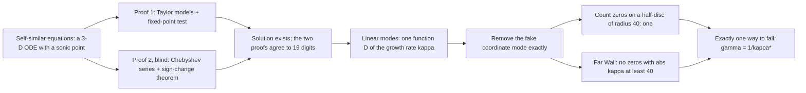
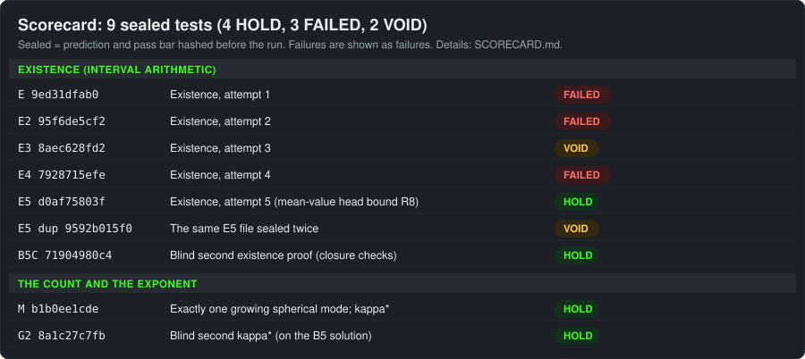

# Does the ball of light exist, and how many ways can it fall?

**A collapsing ball of radiation balanced exactly between becoming a black hole and flying apart (the Evans-Coleman
critical solution) exists, and in round (spherical) linear perturbations it has exactly one way to fall (counting disturbances that are smooth through the sonic point, and not counting the clock-shift mode). We proved both
with a computer that carries a guaranteed error bar on every number; the fall rate gives γ = 0.3558019224 ± 6.97e-11.**

 [](https://github.com/Hashirama1337s)

Moki & Julio · 2026 · version 1.0

**Read** [paper.md](paper.md) · **Re-run** [tools/reproduce.md](tools/reproduce.md) · **Check** [CLAIMS.md](CLAIMS.md) and [SCORECARD.md](SCORECARD.md)

**The magic trick.** Two programs, built in different ways, the second written without seeing the first, proved that the ball
of light exists, and their answers agree to 19 digits. Then a wall built at infinity shuts out every fast-growing or fast-ringing
disturbance, so a finite computation can count all the ways to fall: exactly one.

## In plain words

When radiation (a gas of light) collapses under its own gravity, a small change in the starting push decides between two
fates: a black hole, or a cloud that disperses. Exactly on the dividing line, simulations since 1994 show a special
collapse that keeps its shape while it shrinks. Physicists computed it numerically, and found that it has one unstable
direction, whose rate sets the famous "critical exponent" γ ≈ 0.3558 of black-hole formation. But there was no checkable
proof that this solution exists, and no proof that it has only one unstable direction.

We certified both. Every number in the proof is stored with an error radius, and every step rounds outward, so what comes
out is a theorem, not an estimate. One program follows the solution with Taylor models and closes it with a fixed-point
test; a second, written blind with Chebyshev series and a sign-change theorem, proves it again. Then we counted the
growing disturbances: exactly one, for every round push that is smooth where the fluid moves at the speed of sound.
Its rate is κ* = 2.810552549 ± 3.83e-10. The number itself was already known to eleven digits from 1996 calculations; our count confirms it, and a blind second
computation on the B5 solution adds two certified digits.

**The idea in one picture.** A ball balanced on a ridge: it can roll off in exactly one direction, and we prove there is
no second one. **Where the picture breaks.** This ball is not sitting still. It shrinks forever while keeping its shape,
so "rolling off" means growing relative to the shrinking. And we only test round pushes; lopsided ones are not covered.

## At a glance

- **Claim (computer-assisted).** For the self-similar collapse of a perfect fluid with p = ρ/3 in spherical symmetry: a
  solution exists that is regular at the centre, real-analytic through a saddle-type sonic point, with one zero of the
  fluid velocity inside the sonic point and no second sonic point outside; its sonic velocity (KHA variables) is
  V0 ∈ [0.1124394013880983362 ± 3.31e-20]. On it, there is exactly one growing non-gauge linear mode in Re κ ≥ 0 within
  the class of spherical perturbations analytic through the sonic point, modulo the gauge mode at κ_g = 0.3556992037. It is
  real and simple: κ* ∈ [2.810552549 ± 3.83e-10], γ = 1/κ* ∈ [0.3558019224 ± 6.97e-11].
- **Theorems.** A blind second existence proof (Poincaré-Miranda) whose enclosure agrees with the first to 19 digits. An
  exact gauge deflation of the characteristic function. The Far Wall: no growing mode with |κ| ≥ 40, certified in three
  bands up to infinity.
- **Not new.** The solution, its exponent and the uniqueness of the relevant mode are numerical results of Evans and
  Coleman (1994), Koike, Hara and Adachi (1995), Hara, Koike and Adachi (1996, κ = 2.8105525488) and Maison (1995). HKA
  (1996) asserted existence via a shooting argument and proposed a computer-assisted proof. A blind second implementation
  on the B5 solution encloses a real growth rate in 2.8105525488272 ± 7.32e-14 (certified, beyond the sealed bar). If
  the two solutions coincide (not claimed), HKA's table value 2.8105525488 is right to its last digit and two certified
  digits are added; our first engine alone already agrees with HKA's 9-digit text value 2.81055255. A frequency split
  (analytic bounds at the extremes, interval arithmetic in between) has a Newtonian precedent (Guo, Hadžić, Jang, Schrecker 2025), and the Choptuik (DSS) mode count was done by
  Gonçalves (2026).
- **What is first.** The first interval-arithmetic (computer-assisted) certificate of existence of this solution; the
  third self-similar (type II) critical solution with an existence proof, after Bizoń-Wasserman (CSS) and
  Reiterer-Trubowitz (DSS), and the first for a perfect fluid; the first certified mode count for a continuously
  self-similar critical solution of gravitational collapse, and the first for a fluid.
- **Checked.** Four sealed tests HOLD (E5, B5C, M, G2); earlier existence attempts FAILED three
  times and one was VOID, all listed (a duplicate seal, VOID, was never run). Seven internal hostile referee reports (not external peer review); every blocking fix they
  asked for was made and rerun. Blind second κ* (own equations, own gauge, own code, sealed test G2): HOLD, on the B5 solution, inside our enclosure, 13 digits. Lean checks the Far Wall's Collatz step: the rows on all 133 bulk cells and the tail, and the implication to the bootstrap bound. The entries themselves come from ball arithmetic, so the Far Wall as a whole is not Lean-checked. A clean-room
  replay from this repository alone (fresh copy, documented commands only) regenerated every data file bit for bit and
  reproduced every certified run, including the count and the blind κ*: [results/CLEANROOM-REPORT.md](results/CLEANROOM-REPORT.md).
- **Conditions.** Ball arithmetic (arb) is trusted. Classical theorems (Frobenius, Briot-Bouquet, strong-unstable
  manifold, argument principle, Brouwer, Poincaré-Miranda) are used without proof.

## What we do not claim

- **No local uniqueness.** Neither proof shows the solution is the only one in its box, and we do not claim the two
  proofs found the same solution (their enclosures coincide to 19 digits).
- **Linear and spherical only.** No nonlinear stability, no proof of the black-hole mass law M ∝ (p − p*)^γ (γ = 1/κ* is
  the exponent the KHA/Maison scaling argument predicts), nothing about lopsided (non-spherical) perturbations.
- **Modes, not the full spectrum** of an evolution operator. Perturbations that are not smooth at the sonic point (kink
  modes) are covered only by Harada's criterion: no kink-mode instability, since the sonic point is a certified saddle.
  Harada calls this a necessary condition, so we do not say "stable".
- **Lean does not check the Far Wall.** It checks only the Collatz step (the rational rows and the implication of Corollary 3.1's first sentence).
- **Agreement with the literature is after the fact (POST HOC)**, and so is the agreement of the two existence proofs.
- **Fairness notes are observations.** KHA's printed eq. (18) third line looks like a misprint; HKA's printed gauge mode
  0.35699 looks like a dropped digit of 0.356992; Evans and Coleman's printed m/r and Ω sit 0.25% and 4% above both of our
  implementations, cause untested.
- Review status: one internal hostile referee round on the release text (seats/REFEREE-RELEASE.md, READY WITH FIXES, fixes applied); prior-art refresh to 2026-11-16.

## How it works

### Step 1 - the idea (for anyone)



Because the solution keeps its shape while it shrinks, the field equations become ordinary differential equations in one
variable, x = ln(−r/t). They have a special point where the fluid moves at the speed of sound relative to the shrinking
pattern. The solution must pass through that point smoothly and be regular at the centre. We trap it in a tiny box and
prove that a solution lies in the box.

### Step 2 - how it works (for a curious student)

**Existence.** The program builds the curve of smooth solutions leaving the sonic point and the curve of regular
solutions leaving the centre, each with a proved error bound, and asks whether they meet. A Krawczyk test (an interval
version of Newton's method) shows that they do, inside a box of width about 2e-20 in the sonic velocity. Before trusting
it, the same pipeline must find an exact answer it was never told: flat Friedmann expansion at p = ρ/2, with sonic velocity
−2√2/5. It does. Boxes moved slightly off the solution are refused.

**One way to fall.** Small disturbances grow like e^{κ s}, s = −ln(−t). We build one complex function D(κ) whose zeros are
exactly the physical growth rates, after removing a fake zero caused by the freedom to shift the clock. Counting how many
times D winds around zero along a half-circle of radius 40 gives the number of growing modes inside: one.

**The bridge.** The first counting design needed 21.5 hours. Measuring the error in the natural directions of the waves
(the "characteristic frame") instead of the raw variables shrank one key error term from 1.65e-2 to 1.43e-7. The sealed
count ran in 63 minutes.

### Step 3 - the real thing (for specialists)

The Far Wall is a second-order Levinson slaving z_− = w_− − p w_+ with p = σ̂/κ + χ/κ² + δ (an exact equation), a 3×3
bootstrap closed by a Collatz test (Perron root below 1), a centre zone uniform in |κ| from a closed-form flat kernel and
a Volterra supersolution that scales like 1/|κ|, and a contradiction disc. Bands: [40, 55] (worst ratio 1.0108),
[55, 2000] (1.3145), and |κ| ≥ 2000 by monotonicity in 1/|κ| plus blown-up centre-manifold envelopes (14.77).
[paper.md](paper.md) states the results with exact hypotheses, writes out the main estimates, and lists every sealed test,
referee report and correction. [CLAIMS.md](CLAIMS.md) gives every claim's status and every number's source file.



## Use it as a tool

- **Questions it answers.** Where exactly is the Evans-Coleman solution (sonic data, central density, m/r at t = 0), with
  guaranteed bounds? Is a proposed growth rate a genuine mode or the gauge mode? Is there any growing spherical mode with
  |κ| ≥ 40?
- **Reproduce.** From the repository root (Python 3.11, python-flint 0.9.0; details and every step in
  [tools/reproduce.md](tools/reproduce.md)):
  - `python tools/check_pins.py`: every sealed file against its ledger pin, every file against `MANIFEST.sha256`;
  - `python tools/reproduce.py --tier quick` (about 20 minutes): E5 controls, the blind B5 closure, the Far Wall tail, κ*;
  - `python tools/reproduce.py --tier full` (about 5 hours): everything, including the existence runs, the count on
    the radius-40 half-disc, both Far Wall bands and the blind second κ* (`code/b5g/`), with every data file
    regenerated from source.
  - Expected last line: `[reproduce] ALL CHECKS PASS`. The code is in `code/` (existence: `engine/cert/run_v32.py`;
    blind closure: `b5/close_b5.py`; count and κ*: `engine/cert/count_b4v3.py`; Far Wall: `engine/cert/fw_cert3.py`,
    `engine/cert/fw_tail2.py`), and the shipped logs are in `results/`.
  - Loading a pickle can execute code. The full tier never loads the shipped pickles (it regenerates them), and the
    quick tier loads them only after their sha256 matches the pin.
- **Reuse.** Certified invariant manifolds through a sonic point; a gauge-deflated Evans-type function for self-similar
  problems; a Far Wall recipe that turns "no eigenvalue at large |κ|" into finitely many interval inequalities.

## Words you will meet

- **Critical solution**: the solution sitting exactly on the boundary between collapse to a black hole and dispersal.
- **Self-similar**: keeps its shape while it shrinks; here continuously (CSS), as opposed to the "echoing" (DSS) Choptuik
  solution of a scalar field.
- **Sonic point**: where the fluid moves at the speed of sound relative to the shrinking pattern; the solution must be
  smooth (analytic) there.
- **Mode, growth rate κ**: a small disturbance that grows like e^{κ s}; Re κ > 0 means it grows.
- **Gauge mode**: a fake mode caused by the freedom to shift the clock; it is removed exactly.
- **Critical exponent γ**: 1/κ* for the single growing mode; numerically it controls how small black holes get near
  the threshold.
- **Ball arithmetic**: every number carries a guaranteed error radius, so results are bounds.
- **Far Wall**: our proof that no mode exists with |κ| ≥ 40.
- **Sealed test**: a prediction and its pass bar, hashed before the run and scored as written.
- **Seat**: a separate internal working session of the lab with its own files. Referee seats and blind seats are internal
  checks, not external peer review; a blind seat did not see our code or the values it was asked to reproduce, except as
  disclosed in the paper (Section 9).
- **Lean**: an interactive proof assistant whose kernel checks every step of a formal proof.

## How to cite

```
Moki & Julio (2026). A certified Evans-Coleman critical solution: existence, one growing spherical mode, and its exponent. Version 1.0.
```

Text and data: CC BY 4.0 (`LICENSE`). Code: MIT (`LICENSE-CODE`).

## Related projects

- [certified-bowen-york-spin](https://github.com/Hashirama1337s/certified-bowen-york-spin): the certified spin ceiling of Bowen-York black holes
- [certified-kummer-k3](https://github.com/Hashirama1337s/certified-kummer-k3): a certified closeness bound for a Kummer K3 surface
- [certified-chen-lebrun-weber](https://github.com/Hashirama1337s/certified-chen-lebrun-weber): a certified approximation of the Chen-LeBrun-Weber Einstein metric
- All projects: [the Moki & Julio lab map](https://github.com/Hashirama1337s)

---

*Prepared with AI assistance; what was checked, and by what, is stated above.*
